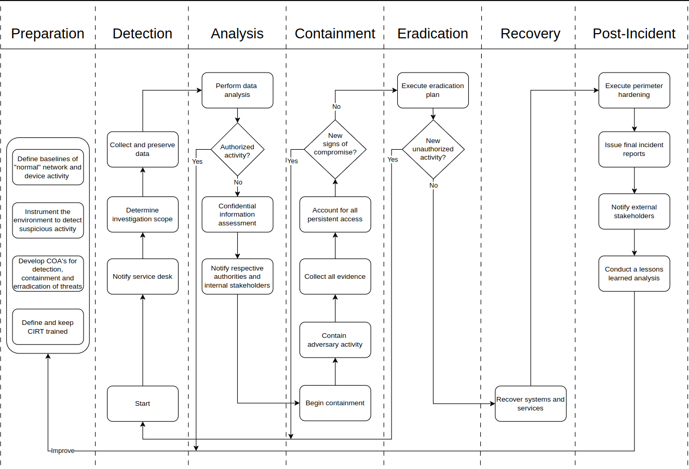

Click here for the portuguese version.

## Project purpose
An **adverse cybersecurity event** is an observable occurrence involving computing assets with some negative consequence. Because of the damage that these events can cause, it is vital to respond quickly to ocurrences.
Organizations must have policies to govern their cybersecurity incident response:   
- A policy must establish a purpose, scope (to whom, to do what, under what circumstances), related events, roles and authorities, guidelines for processes.  
- Processes should be based on the incident response policy. Their documentation explains how technical procedures are to be performed. They must be tested periodically to evaluate quality (e.g., tabletops).  
Effective implementation of processes of incident response enable systematic action, clearly established personnel roles and functions, reducing the overall impact of incidents.  

Following the **NIST SP 800-61r3** [1] and **CISA-PB** [2], this project implements a high level incident response playbook, and a tabletop simulation (**a huge thanks to my colleagues**) to evaluate its flaws and implement corrections. That way, a better understanding of correct procedures under pressure will be accomplished.  

  
   
  <em>A high level IR playbook.</em>

<table>
  <tr>
    <td align="center">
      
       <em>The "High trained organization personnel"</em>
    </td>
    <td align="center">
      
       <em>Identification badges</em>
    </td>
  </tr>
</table>

## Repository structure
- [[docs/lifecycle-overview](./docs/lifecycle-overview.md)] An explanation of a playbook life cycle. 
- [[docs/tabletop-description](./docs/tabletop-description.md)] A description of planning and execution of the tabletop. 
- [[files](./files)] All playbook files and versions.

## Key takeaways
- There are international organizations that guide any size business to more safe cybersecurity operational levels (e.g., NIST, CISA).
- It is huge the importance to establish and document incident response policies to reduce impacts. Playbooks are a good way to document these processes.
- Even with an existing and well documented policy to incident response, the organization personell may not perform a good response. Hence the importance of training exercises like the tabletop performed in this project.
- The incident response policy needs to be shared across all organization sectors. So everyone stays on the same page during a response.
- Different personnel from different sectors **will** make decisions guided by their own responsabilities and strongest interests. Hence the importance of preparing policies taking everyone's point of view. 
- A trained mediator (or a team of them) is necessary to manage team work incident response situations since personell tension can escalate quickly.

## References
- **[1]** Nelson A, Rekhi S, Souppaya M, Scarfone K (2025) Incident Response Recommendations and Considerations for
Cybersecurity Risk Management: A CSF 2.0 Community Profile. (National Institute of Standards and Technology,
Gaithersburg, MD), NIST Special Publication (SP) NIST SP 800-61r3. https://doi.org/10.6028/NIST.SP.800-61r3
- **[2]** Cybersecurity and Infrastructure Security Agency (2021) Cybersecurity Incident & Vulnerability Response Playbooks: Operational Procedures for Planning and Conducting Cybersecurity Incident and Vulnerability Response Activities in FCEB Information Systems. (Cybersecurity and Infrastructure Security Agency, Arlington, VA). Available at https://www.cisa.gov/sites/default/files/2024-08/Federal_Government_Cybersecurity_Incident_and_Vulnerability_Response_Playbooks_508C.pdf
